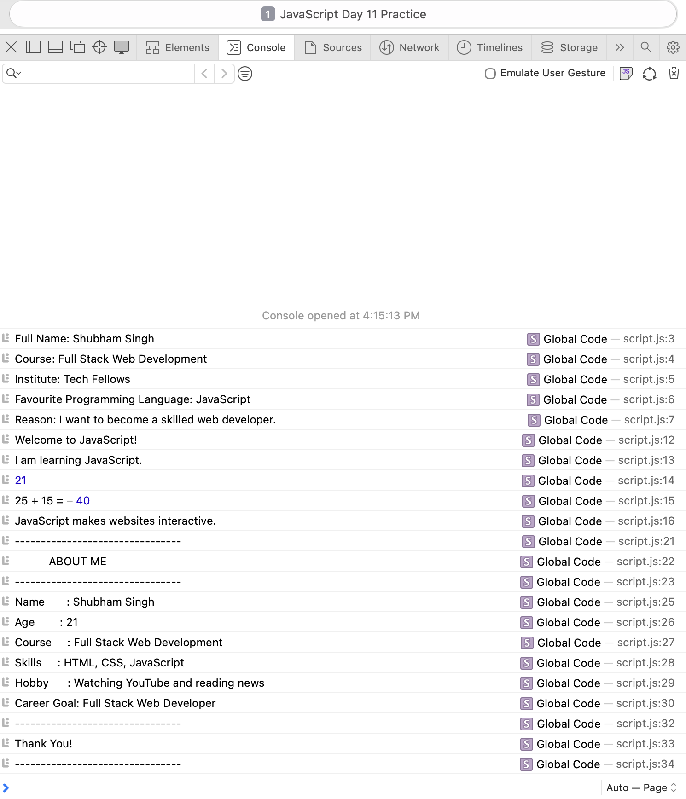

# Day 11: Introduction to JavaScript

## About This Project
This project is part of the Tech Fellows practical assignment. The main objective is to understand JavaScript basics, connect an external JavaScript file with HTML, and display output using `console.log()`.

## Project Structure

```text
Day11_JavaScript_Introduction/
│
├── index.html
├── script.js
└── README.md
```

## Technologies Used
- HTML5
- JavaScript

## Tasks Completed

### Task 1: Project Folder
Created a folder named `Day11_JavaScript_Introduction` with `index.html` and `script.js`.

### Task 2: Connect JavaScript with HTML
Connected the external JavaScript file using the script element before the closing body tag.

### Task 3: Practice console.log()
Displayed my personal information:
- Full Name: Shubham Singh
- Course: Full Stack Web Development
- Institute: Tech Fellows
- Favourite Programming Language: JavaScript
- Reason: I want to become a skilled web developer.

### Task 4: Different Outputs
Practiced displaying text, numbers, messages, and calculations using `console.log()`.

### Task 5: Questions and Answers

**1. What is JavaScript?**

JavaScript is a programming language used to make websites interactive and dynamic.

**2. What is the difference between HTML, CSS, and JavaScript?**

- HTML creates the structure of a webpage.
- CSS adds styling and design.
- JavaScript adds functionality and interactivity.

**3. Why do websites use JavaScript?**

Websites use JavaScript to handle user interactions, validate forms, and display dynamic content.

**4. What is the purpose of the script element in HTML?**

The script element is used to add JavaScript code or connect an external JavaScript file to an HTML document.

**5. What is the browser console, and how do you open it?**

The browser console is a developer tool used to view JavaScript output and errors. On Mac, press `Command + Option + J` in Chrome to open it.

### Mini Challenge: About Me Console Card

Created an About Me card in the browser console using multiple `console.log()` statements.

It includes:
- Name
- Age
- Course
- Three Skills
- Hobby
- Career Goal

## How to Run This Project

1. Download or clone this repository.
2. Open the `Day11_JavaScript_Introduction` folder.
3. Open `index.html` in Google Chrome.
4. Press `Command + Option + J` on Mac.
5. Open the Console tab to see the JavaScript output.

## Screenshots

Add your actual browser screenshots here after completing the project.

- Browser Page Screenshot
- Browser Console Screenshot

## Learning Outcome

Through this task, I learned the basics of JavaScript, how to connect an external JavaScript file to HTML, and how to display output using `console.log()`.

---

**Created by:** Shubham Singh  
**Program:** Tech Fellows

## Screenshots

### Browser Page


### Browser Console

