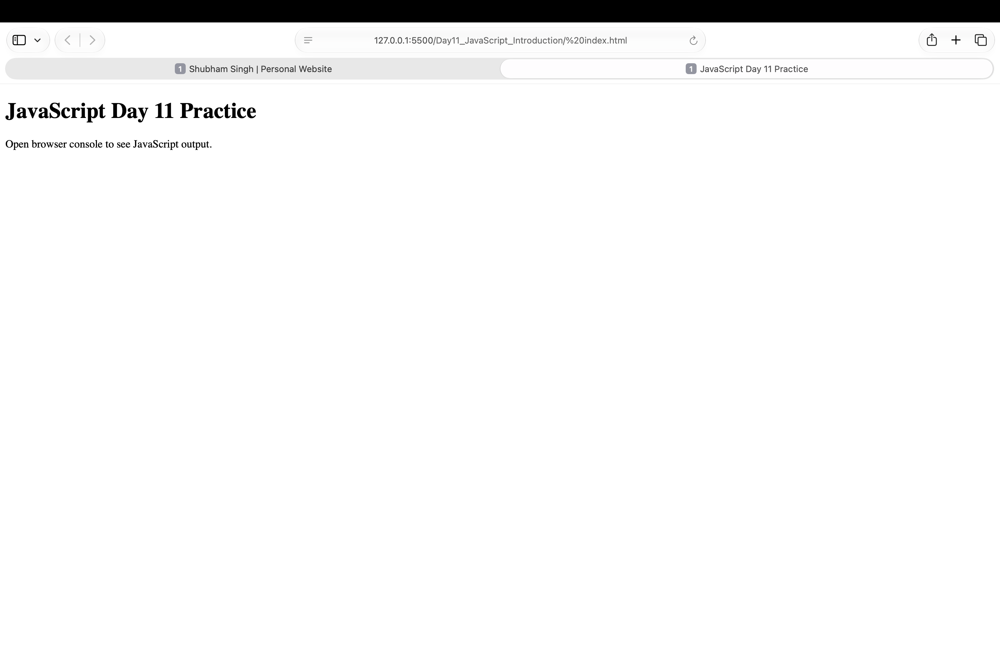

# Day 11: Introduction to JavaScript

## Project Overview
This project is part of the Tech Fellows practical assignment. It focuses on learning the basics of JavaScript and using console.log() to display output.

## Technologies Used
- HTML5
- JavaScript

## Tasks Completed
1. Created a project folder.
2. Connected external JavaScript with HTML.
3. Practiced console.log().
4. Displayed text, numbers and calculations.
5. Created an About Me Console Card.

## About Me
- **Name:** Shubham Singh
- **Age:** 21
- **Course:** Full Stack Web Development
- **Institute:** Tech Fellows
- **Skills:** HTML, CSS, JavaScript
- **Hobby:** Watching YouTube videos and reading news articles
- **Career Goal:** Full Stack Web Developer

## Questions and Answers

**1. What is JavaScript?**

JavaScript is a programming language used to make websites interactive and dynamic.

**2. Difference between HTML, CSS and JavaScript?**

- HTML creates the structure.
- CSS provides styling.
- JavaScript adds functionality.

**3. Why do websites use JavaScript?**

To make websites interactive and handle user actions.

**4. What is the purpose of the script element in HTML?**

It connects JavaScript code to an HTML page.

**5. What is the browser console?**

It is a developer tool used to display JavaScript output and errors.

## How to Run
1. Open index.html in a browser.
2. Open the browser's Developer Console.
3. View the JavaScript output.

## Screenshots

### Browser Page

### Browser Console

## Learning Outcome
I learned how to connect JavaScript with HTML and display output using console.log().

**Created by:** Shubham Singh  
**Program:** Tech Fellows
